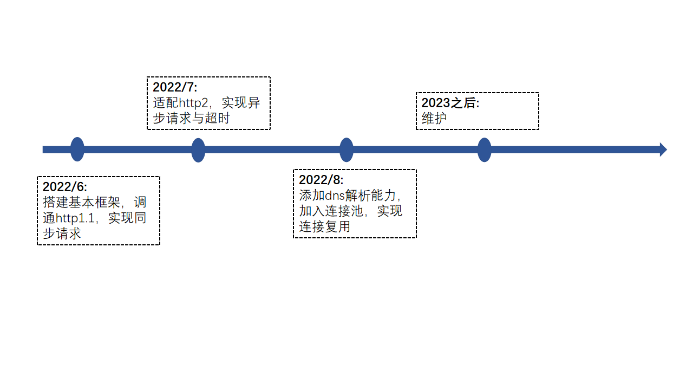
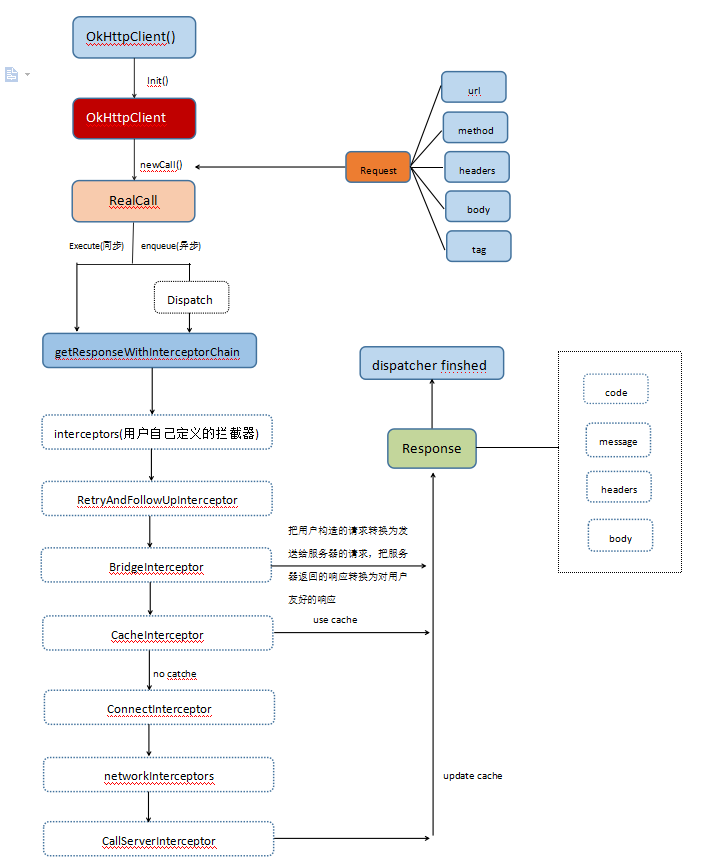

<p align="center">

</p>

<p align="center">


</p>

## 介绍

OkHttp 是一个高效的 HTTP 客户端, 代码参考: https://github.com/square/okhttp/tree/okhttp_3.14.x

### 特性

- 🚀 支持HTTP/2，允许所有同一个主机地址的请求共享同一个 socket 连接

- 🌍 连接池减少请求延时

- 💪 缓存响应内容，避免一些完全重复的请求

### 路线

<p align="center">

</p>

##  软件架构

### 架构图

<p align="center">

</p>

### 源码目录

```shell
.
├── README.md
├── doc
│   ├── assets
│   ├── cjcov     
│   ├── api.md  
│   ├── design.md  
│   ├── proposal.md
│   └── xxx_lib.md 
├── lib
│   └── libdns.so
├── src
│   ├── address.cj
│   ├── bridge_interceptor.cj
│   ├── builder.cj
│   ├── cache_control_builder.cj
│   ├── cache_control.cj
│   ├── call.cj
│   ├── call_back.cj
│   ├── call_server_interceptor.cj
│   ├── connect_interceptor.cj
│   ├── dispatcher.cj
│   ├── exception.cj
│   ├── exchange_codec.cj
│   ├── exchange_finder.cj
│   ├── interceptor.cj
│   ├── ok_http_client.cj
│   ├── ok_http_client_builder.cj
│   ├── protocol.cj
│   ├── queue.cj
│   ├── real_connection.cj
│   ├── real_connection_pool.cj
│   ├── request.cj
│   ├── request_body.cj
│   ├── request_builder.cj
│   └── response.cj
│   └── response_body.cj
│   └── response_builder.cj
│   └── retry_and_follow_up_interceptor.cj
│   └── status_line.cj
│   └── socket_ffi.cj
│   └── transmitter.cj
│   └── util.cj
└── test   
    ├── HLT
    ├── LLT
    └── UT
```
- `lib`依赖 c 库的dns解析接口的动态链接文件
- `doc`是库的设计文档、提案、库的使用文档、LLT 覆盖报告 ( 由于未支持服务端的对接,部分拦截器连接后处理逻辑暂时无法覆盖)
- `src`是库源码目录
- `test`是存放测试用例，包括 HLT 用例、LLT 用例和 UT 用例

### 接口说明

主要是核心类和成员函数说明,详情见 [API](./doc/api.md)

##  编译执行

### 编译

编译描述和具体shell命令

```shell
cpm update
cpm build
```

### 示例

注意：以下示例若在本地不成功，可能是 url 地址请求失败，请换成实际可用地址。

```
from okhttp import okhttp.*
from net import http.*
from std import collection.*
from encoding import url.*
from net import tls.*

main (){
    let client = OkHttpClient.builder()
                        .addNetworkInterceptor(MyInterceptor())
                        .protocols(ArrayList<String>([Protocol.get("HTTP/2.0").toString(),Protocol.get("HTTP/1.1").toString()]))
                        .build()

    let request: okhttp.Request = okhttp.Request
                        .builder()
                        .url("http://36.152.44.95/index.html")
                        .header(Header())
                        .header("User-Agent", "OkHttp-Example")
                        .build()
    let response: okhttp.Response = client.newCall(request).execute()
    return 0
}

class MyInterceptor<: Interceptor {
    public func intercept(chain: Chain): okhttp.Response {
        let conn = chain.getConnection().getOrThrow()
        conn.getRoute()
        let add = Address(URL.parse("http://36.152.44.95/index.html"),
                            ArrayList<String>([Protocol.get("H2_PRIOR_KNOWLEDGE").toString()]),
                            Option<TlsClientConfig>.None
                        )
        add.getTlsConfig()
        conn.noExchanges()
        println(conn.isMultiplexed())
        conn.cancel()
        let request: okhttp.Request = chain.getRequest()
        let header: Header = request.getHeaders()
        let c = request.getCacheControl() ?? CacheControl.parse(header)
        println(c.toString())
        return okhttp.Response.builder().build()
    }
}
```

执行结果

```
false
no-cache, no-store, max-age=0, s-maxage=0, private, public, must-revalidate, max-stale=0, min-fresh=0, only-if-cached, no-transform, immutable
```
##  参与贡献

主要写参与贡献的人以及个人主页链接

[@guo_tingtingtekla](https://gitee.com/guo_tingtingtekla)[@luoyukai4](https://gitee.com/luoyukai4)